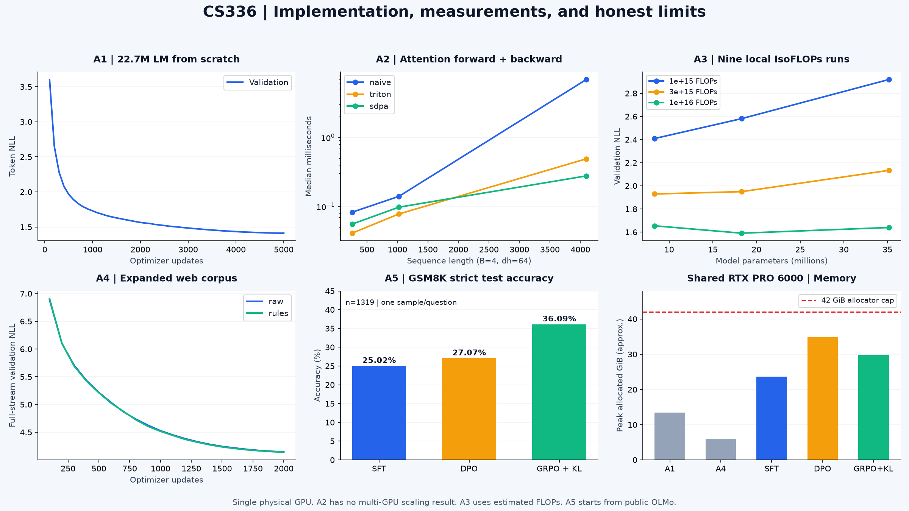

<div align="center">

# CS336 Spring 2026 · Learning Assignments

**从字节 BPE、Transformer 到数据治理与数学推理 GRPO**

[课程笔记 ↗](https://github.com/lvsir18/CS336Spring-2026-Learning-Notes) · [五份实验教程](#学习与实现导航) · [从零复现](docs/operations.md) · [结果与证据](results/README.md)

单卡 **RTX PRO 6000 Blackwell 96GB** · 共享设备 · **42 GiB PyTorch allocator 上限**

</div>



| 作业 | 已完成的实测内容 | 关键结果 | 范围说明 |
|---|---|---|---|
| **A1 · Basics** | 自写BPE、22.7M Transformer、AdamW；327.68M token训练 | val loss **1.41168** / PPL **4.10283** | 固定抽样验证，非完整验证集评分 |
| **A2 · Systems** | Flash/Triton前后向、benchmark、CPU双rank分片验证 | T4096 fwd+bwd：Naive **6.886ms** → Triton **0.490ms** | SDPA为0.277ms；**未做真实多GPU/NCCL扩展实验** |
| **A3 · Scaling** | 3个规模 × 3个估算FLOPs预算 | 1e16预算中18.3M模型loss **1.59087** | 本地9点；边界最优，不作大规模外推 |
| **A4 · Data** | 真实CC数据、匹配token消融、15-shard扩容 | raw/rules loss **4.14461 / 4.13960** | 每组65.536M训练token；规则增益很小 |
| **A5 · Alignment** | OLMo全参数SFT、真实偏好DPO、GRPO/KL | GSM8K：**25.02% / 27.07% / 36.09%** | 1319题单次采样strict；仅验证选模 |

> A1/A4从随机初始化训练；**A5另用公开OLMo权重**，不是将A4 checkpoint继续做RL。五个作业共同覆盖学习链条，不能说成同一个模型已端到端训练完成。

## 学习与实现导航

每章包含**实际结果 → 复现命令 → 数学原理 → 关键代码 → 实验限制**。建议先理解A1，再读A2/A3；从数据工程角度回看A4，最后学习A5。

| 教程 | 核心实现 | 对应课程笔记 |
|---|---|---|
| [A1：从字节到语言模型](docs/a1.md) | [BPE](src/cs336_basics/tokenizer.py) · [Transformer](src/cs336_basics/model.py) · [AdamW](src/cs336_basics/optimizer.py) | [01 Tokenization](https://github.com/lvsir18/CS336Spring-2026-Learning-Notes/blob/main/lectures/01-overview-tokenization.md) · [03 架构](https://github.com/lvsir18/CS336Spring-2026-Learning-Notes/blob/main/lectures/03-architecture-hyperparameters.md) |
| [A2：内核与分布式](docs/a2.md) | [Triton](src/cs336_systems/flash_triton.py) · [DDP/ZeRO/FSDP](src/cs336_systems/distributed.py) | [05–08 系统](https://github.com/lvsir18/CS336Spring-2026-Learning-Notes/blob/main/lectures/05-gpu-flashattention.md) |
| [A3：计算预算与规模](docs/a3.md) | [拟合](src/cs336_scaling_lab/fit.py) · [预算计划](scripts/plan_remaining.py) | [09 Scaling Laws](https://github.com/lvsir18/CS336Spring-2026-Learning-Notes/blob/main/lectures/09-scaling-laws.md) · [11 实践](https://github.com/lvsir18/CS336Spring-2026-Learning-Notes/blob/main/lectures/11-scaling-practice.md) |
| [A4：网页处理与对照](docs/a4.md) | [过滤](src/cs336_data/filters.py) · [去重](src/cs336_data/dedup.py) · [语料扩容](scripts/prepare_optimization_data.py) | [13 数据来源](https://github.com/lvsir18/CS336Spring-2026-Learning-Notes/blob/main/lectures/13-data-sources.md) · [14 过滤](https://github.com/lvsir18/CS336Spring-2026-Learning-Notes/blob/main/lectures/14-data-filtering-dedup.md) |
| [A5：SFT / DPO / GRPO](docs/a5.md) | [损失与RL更新](src/cs336_alignment/core.py) · [完整训练器](scripts/train_alignment_formal.py) | [15 SFT/DPO](https://github.com/lvsir18/CS336Spring-2026-Learning-Notes/blob/main/lectures/15-sft-rlhf-dpo.md) · [16 GRPO](https://github.com/lvsir18/CS336Spring-2026-Learning-Notes/blob/main/lectures/16-rlvr-grpo.md) |

## 实验环境与可复现性

Linux、Python3.12.15、PyTorch2.11.0+cu130、Triton3.6.0、Transformers5.7.0。设备只有**一张物理GPU**，与其他任务共享。队列空闲至少49GiB才启动，实际GPU训练进程设置42GiB allocator上限；这个上限不是整个设备的独占预留，也不限制所有外部CUDA分配。

| 训练任务 | PyTorch peak allocated（约GiB） |
|---|---:|
| A1 | 13.44 |
| A4 扩容 | 5.98 |
| A5 SFT | 23.68 |
| A5 DPO | 34.81 |
| A5 GRPO + KL | 29.8 |

显存预算是上限，不要求每次占满40–50GB。A2内核和A3小模型也不需要人为扩大到这个占用。A2分布式只在CPU/Gloo验证教学实现，真实多GPU/NCCL吞吐、扩展效率、跨节点和生产级分片优化均未完成。A3没有调用官方API；A4没有完成官方8.59B-token协议；A5不是官方榜单复现。

```bash
git clone https://github.com/lvsir18/CS336Spring-2026-Learning-Assignments.git
cd CS336Spring-2026-Learning-Assignments
bash scripts/setup_linux.sh
source .venv/bin/activate
python scripts/fetch_runtime_assets.py
```

后续下载、训练、恢复与依赖顺序见[完整操作说明](docs/operations.md)。训练器保存模型、Adam状态、全部RNG、进度和数据身份；SFT/DPO还保存无放回sampler与最佳模型选择。`--resume auto`恢复最新可用完整状态。数据准备、偏好生成和训练分别有状态，CPU阶段GPU为0属正常。

## 仓库内容

`src/` 是关键实现；`scripts/` 是实际运行入口；`configs/` 放A1初始配置，其余由版本化计划生成；`docs/` 是五章详细教程与操作说明；`results/` 放训练指标、验证选择与测试数值；`provenance/` 放版本、数据摘要、环境和核验清单。

没有上传本地/上游测试、调试阶段重复文档、权重、网页正文、训练数据或缓存。运行时tokenizer/prompt按哈希下载；第三方参考模型与评分器保留许可，见[来源与许可](THIRD_PARTY_NOTICES.md)。本仓库是个人学习记录，课程依据为[Stanford CS336](https://cs336.stanford.edu/)。
