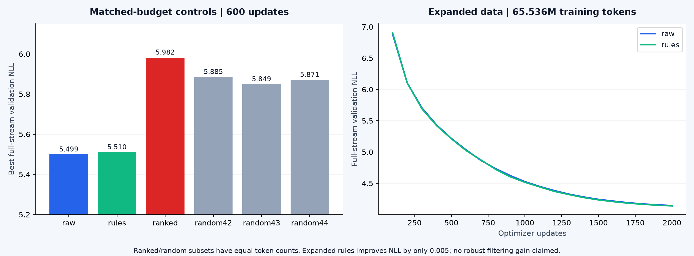

# A4：把网页变成值得模型学习的数据

[← 结果首页](../README.md) · [复现与恢复](operations.md) · [配套笔记 13](https://github.com/lvsir18/CS336Spring-2026-Learning-Notes/blob/main/lectures/13-data-sources.md) · [配套笔记 14](https://github.com/lvsir18/CS336Spring-2026-Learning-Notes/blob/main/lectures/14-data-filtering-dedup.md)


## 最终结果：语料规模比硬筛更值得先检查



| 同一600步短对照 | 独立训练token | 最好验证loss | 最好step |
|---|---:|---:|---:|
| raw | 6,717,253 | **5.49918** | 600 |
| rules | 6,271,540 | 5.51001 | 600 |
| ranked，Wiki代理分数top30% | 2,247,577 | 5.98177 | 400 |
| 等token random42 / 43 / 44 | 各2,247,577 | 5.88502 / 5.84868 / 5.87079 | 400 / 450 / 400 |

6组均训练19,660,800累计token，相同初始化、LR日程、PII和完整验证口径。ranked比随机子集均值5.86817更差，说明“更像Wikipedia”不能直接视作更适合本任务的训练质量。random只改变子集抽样种子，不是3次完整训练随机种子重复。

| 扩容后的对照 | 文档 | 独立训练token | 累计训练token | 最终/最佳loss | PPL |
|---|---:|---:|---:|---:|---:|
| raw | 72,883 | 110,846,445 | 65,536,000 | 4.144608 | 63.0929 |
| rules | 66,431 | 103,273,752 | 65,536,000 | **4.139597** | **62.7775** |

扩容实际用了15个WET shard。两组均2,000更新，最优点都在末步；rules只低0.00501，**没有充分证据证明规则带来稳定提升**。相较旧轮clean loss9.17865，扩容避免了小语料约29倍重复，但跨轮还改变了PII/验证/LR等协议，不能把所有改善单因果归到数据量。

结果配置和曲线在[results/a4](../results/a4)，数据来源与数量在[扩容manifest](../provenance/optimization-v1-a4-expanded-manifest.json)。模型78,734,848参数，d512/L8/H8/FF1536/T512，GPT2词表50,257；参考架构与A1自己的模型实现分开。micro8×accum8=64序列，每次32,768token；LR6e-4，warm60，cosine最低6e-5。验证顺序覆盖共同token流中的846,336个目标token，末尾不足512的部分不计。

## 完整复现步骤

```bash
source .venv/bin/activate
python scripts/fetch_runtime_assets.py
python scripts/fetch_formal_assets.py --endpoint https://huggingface.co
python scripts/prepare_remaining_data.py --part web
python scripts/prepare_optimization_data.py --part small
python scripts/prepare_optimization_data.py --part expanded --target-tokens 100000000 --max-shards 64
python scripts/plan_optimization.py
```

第一步获取GPT2 vocab/merges；第二步下载固定版本分类器、WikiText参考数据和CC WET/WARC样例。web步骤先用独立200页面验证WARC正文抽取，正式LM对照使用WET文本；构造固定验证hosts和分离的分类器参考语料。small步骤统一PII，保留ranked对照并构造3份精确匹配token的随机子集。expanded步骤排除验证host、额外下载同snapshot的shards，直到rules≥100M独立token；每个文档最多200,000字符/8,192token。

实际GPU训练配置由plan生成，原配置也保存在各个[结果子目录](../results/a4)的config.json中。可逐个执行：

```bash
for name in a4-small-raw a4-small-rules a4-small-random42 a4-small-random43 a4-small-random44 a4-small-ranked a4-expanded-raw a4-expanded-rules; do
  python scripts/gpu_budget.py --allocator-gib 42 --min-free-gib 48 \
    --report "runs/optimization-v1/${name}-memory.json" -- \
    scripts/train_lm.py --config "runs/optimization-v1/configs/${name}.json"
done
```

以上是分解说明；[总队列](operations.md)会自动串联相同阶段和恢复，二者选一种执行，避免重复启动同一目录。A4单项复现不需要先完成A5。

## 数据治理的实做范围

expanded的raw/rules都做语言过滤、PII mask、长度限制与精确token文档去重；rules额外做可读性/NSFW/toxic过滤。只有早期small-ranked研究使用Wiki质量代理和MinHash流程，**扩容主实验没有额外做全量跨域近重复聚类**。验证隔离采用规范化host及其哈希，不等同于注册域级隔离；没有完成互联网规模分布式去重，也没有用WARC重抽取全量LM训练数据。本实验不是官方8.59B-token训练协议。


---

## 原理与关键实现详解

对应 [官方 A4](https://github.com/stanford-cs336/assignment4-data)。代码：[filters.py](../src/cs336_data/filters.py)、[dedup.py](../src/cs336_data/dedup.py)、[process_crawl.py](../scripts/process_crawl.py)、[training.py](../src/cs336_basics/training.py)。

## 1. 数据工程为什么属于模型训练

预训练会放大语料中的规律，也会学到重复模板、导航栏、乱码、垃圾广告和隐私字段。训练更多低质量 token 可能消耗同样计算却学到更差的分布。A4 的目标是构造可解释、可追溯的数据处理流水线，再用固定模型与预算验证它是否提高泛化。

“过滤后文档更干净”是中间结果；“同样训练预算下，在独立目标分布上 loss 更低”才是模型层面的证据。两个结论必须分开记录。

## 2. 从 Common Crawl 开始理解记录格式

WARC 保存抓取响应与元数据，可以包括 HTTP header、HTML 和来源 URL；WET 是提取的文本，体积通常更方便处理，但无法再完整控制原始 HTML 抽取。处理压缩记录流时，应逐记录读取，不能把所有网页一次读入内存。

每条文档至少保留来源、record ID 或 URL、原始/清洗文本摘要、处理版本、保留/拒绝原因与时间。将这些 provenance 和正文分开保存，使后续能检查误删样本与来源偏差。

仓库 `process_crawl.py` 支持 WARC/WET/JSONL 的对应入口；具体命令先运行 `--help`。公共抓取路径会变化，下载时记录确切 crawl、文件路径与哈希，不把某个示例文件当成完整互联网语料。

## 3. HTML 提取不等于删除尖括号

简单正则去标签会错误保留脚本、样式、菜单、版权声明，也可能破坏实体和段落。仓库用 resiliparse 做 HTML 到正文的抽取；正文质量仍需人工抽样，而不是假设库输出必然正确。

看一个输入：`<nav>Home Login</nav><article><p>A useful article.</p></article><script>...</script>`。我们真正希望学到的是文章正文。若大量站点共享同一导航栏，模型会反复学习这些模板，且后续去重可能把相似页面聚成错误的大簇。

文本解码应明确编码与错误处理。空文本、纯符号、超长记录与解析异常应有可统计的处理结果，不能静默消失，否则无法解释过滤保留率。

## 4. 语言识别、NSFW、毒性与质量分类

fastText 把文本表示成词/字符 n-gram 特征的聚合，再做浅层分类。它比大模型便宜，适合对大量文档做初筛，但不是无误判的真值来源。

仓库 `identify_language`、`classify_nsfw`、`classify_toxic_speech`、`classify_quality` 懒加载真实模型文件。没有模型权重时应明确报错，不用关键词规则伪装成训练好的分类器分数。

需要区分 label 与 confidence：阈值越高，保留下来的目标语言可能更纯，但短文本和混合语言更容易被误删；“非目标语言”与“质量差”也不是同一个属性。报告每个阈值、每类删除比例与抽样错误，而不是只给一个总保留率。

质量分类器需要定义正负样本。将维基百科参考文本作为正类、网页抓取作为负类时，模型可能学到的是来源风格，而不是通用质量。必须保留独立验证与来源分布，检查被高分选择的真实网页是否符合目标。若使用 WikiText 替代某个指定参考集合，应明确标为代理数据。

[train_quality_classifier.py](../scripts/train_quality_classifier.py) 和 [prepare_remaining_data.py](../scripts/prepare_remaining_data.py) 提供训练与数据准备入口。本次已下载语言/NSFW/毒性模型并训练Wiki代理分类器；其局限和扩容后放弃硬筛的理由见本章结果。

## 5. PII 与规则过滤的顺序

PII 处理识别邮箱、电话号码和 IPv4 等模式，用占位符替换，尽量保留句子的语言结构。例如 `contact me at a@b.com` 变为 `contact me at |||EMAIL_ADDRESS|||`（具体占位符以源码为准）。

正则只覆盖有限格式：电话号码可能与日期、编号混淆；IPv4 各段必须0–255，不能只看“数字点数字”的形状；邮箱匹配也不是隐私识别的完整系统。抽样误报和漏报是必要步骤。

Gopher 风格质量规则综合词数、平均词长、字母比例、符号或特定行的占比等统计。边界的 `>` 与 `>=` 会影响官方测试与实际保留集合。先读源码中的精确阈值，再构造恰好处在边界的样例检查。

过滤顺序会改变后续结果：PII 替换可能使多个不同页面更相似；删除空白或标点会改变 shingles；先去重和先过滤可能保留不同代表文档。因此把流水线顺序视为实验配置的一部分。

## 6. 完全重复、重复行与近似重复

整文档 exact dedup 可以按规范化正文 SHA256 保留第一份；它适合处理完全相同页面，但检测不到只改了几个词的副本。

本作业的 exact line dedup 采用两遍：第一遍统计所有文件中的行频率，第二遍只输出频率为1的行。**重复行被全部删除，不是仅删除第二次以后的副本。** 这有助于去除跨网页导航模板，但也会删除不同文档里恰好相同的合法句子。

```python
# dedup.py 实际核心
counts.update(line.rstrip('\r\n') for line in source)
# 第二遍
if counts[line.rstrip('\r\n')] == 1:
    destination.write(line)
```

只去除行尾换行，不等于完全 strip；额外空格是否参与相等关系，是明确的实现约定。空行处理、同文件内重复和跨文件重复都应测试。

## 7. MinHash：把大集合相似度压成签名

先标准化：小写、Unicode NFD 分解、去组合音标、标点替换为空格、分词。再用连续 n 个词组成 shingle 集合，例如 `the red cat sat down` 的3-gram是 `{the red cat, red cat sat, cat sat down}`。

两个集合 A/B 的 Jaccard 相似度为 `|A∩B|/|A∪B|`。如果每对文档都算完整 Jaccard，M 篇文档需要约 O(M²) 个比较，无法扩展。

MinHash 对集合中的元素使用多个伪随机哈希函数，各取最小值组成签名。理想随机排列下，两个集合某一项最小值相同的概率等于 Jaccard。仓库先用 BLAKE2b 将 shingle 映射为整数，再用固定 seed 生成的 `(a*x+b)%prime` 近似多个随机哈希。

```python
signature = [min((a*x+b) % prime for x in values)
             for a,b in coefficients]
```

签名不是可逆压缩，也不是文档的密码学身份；它是用于相似度候选召回的统计表示。

## 8. LSH：怎样避免逐对比较

把 h 项签名分为 b 个 band，每个 band r=h/b 项。只要某个 band 完全相同，就把两篇文档列为候选。对于 Jaccard 为 s 的理想情形，被召回的概率近似：

`P(candidate)=1-(1-s^r)^b`。

例如100个哈希、20个band，每band5项。s=0.8 时召回概率约0.9996；s=0.2 时约0.0064。增加 band 通常增加召回但也增加候选量；这不是硬阈值分类器。

仓库用 LSH 找候选后，再算完整 Jaccard，只有达到阈值才 union 两个文档。这样能减少假阳性合并，但 LSH 未召回的相似对仍会漏掉，不能声称全量近重复被精确找全。

```python
similarity = len(tokens & other) / len(tokens | other)
if similarity >= jaccard_threshold:
    union(idx, candidate)
```

union-find 把相似关系的连通分量聚成簇，保留最小索引代表。需要理解传递性：A近似B、B近似C，但A可能并不近似C，三者仍可能同簇。代表选择与排序会影响最终分布，应固定输入次序。

短文档没有 n-gram 时，仓库保留整词 tuple 作为非空特征，避免所有短文都变成相同空集合。当前实现把 shingle 集合等保留在内存，适合教学/中等规模；互联网规模需要外部排序、分桶落盘、分布式候选生成和更精细的内存设计。

## 9. 公平评估清洗效果

设计至少两个语料版本：raw baseline 和 filtered/dedup。使用相同 tokenizer、架构、训练 token 数、验证集和 seed。若只训练相同步数但过滤后数据更少、重复次数更多，应同时报告独立数据量与累计训练 token。

建立逐阶段统计表：输入文档数/字节、各规则删除数、剩余 token、长度分布、域名分布、语言分布、近重复簇大小与人工抽样。保留少量接受/拒绝样本供审查，不把敏感原文直接上传 GitHub。

验证集合不能参与 quality classifier 训练或阈值挑选；如果要多次调阈值，保留最终未用于调参的测试集合。跨 split 去重比仅在训练集内部去重更重要，否则模型可能“见过验证题”。

真实网页实验的有效性应由本章固定训练预算的消融和扩容对照判断。

## 10. A4 参考模型训练与当前显存

官方参考模型位于 [cs336_a4_reference](../src/cs336_a4_reference/model.py)，保留上游 MIT 许可与独立命名空间。它与 A1 模型接口相似，但优化器、学习率、词表和高效 attention 路径各有具体约定，不能只把 A1 checkpoint 改个文件名加载。

完整参考配置 d1024、L24、f3072、V50257、T512，总参数约430M。全局batch1024，16,384更新对应8,589,934,592 token。单卡可用梯度累积保持相同有效batch，但没有多卡吞吐，耗时可能很长。

其 FP32 Adam 静态状态约6.41GiB，但激活、logits、优化器临时项和评测 batch 都会增加峰值。尤其 `eval_batch_size=128` 并不因为 no_grad 就没有显存风险：大词表 logits 仍然存在。40–50GiB预算下，应先减小 microbatch 和评测 batch、相应增加累积/评测批数，再测量。

```bash
.venv/bin/python scripts/process_crawl.py --help
.venv/bin/python scripts/dedup_corpus.py --help
.venv/bin/python scripts/corpus_to_text.py --help
.venv/bin/python scripts/train_quality_classifier.py --help
.venv/bin/python scripts/train_lm.py --help
```

正式队列使用training.py的a4_reference分支，复用A1原子检查点、配置校验、日志回退和信号保存。

练习：手算两个文档的5-shingle Jaccard；用同一句正文加不同导航栏观察近重复召回；构造A–B–C链解释聚簇结果；比较先PII替换再去重与相反顺序；用固定计算量训练两个清洗版本，解释为何保留率更低不必然更好。
