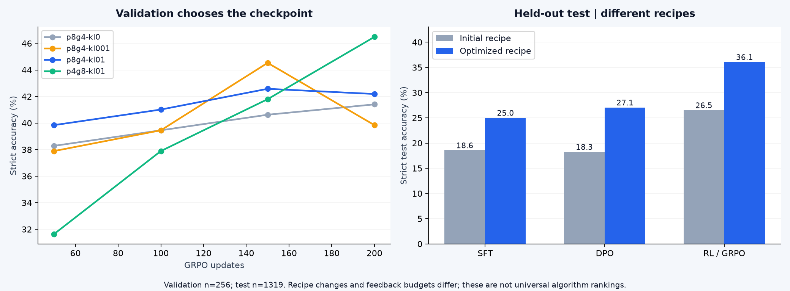

# A5：从基础语言模型到会回答、会推理的策略

[← 结果首页](../README.md) · [复现与恢复](operations.md) · [配套笔记 15](https://github.com/lvsir18/CS336Spring-2026-Learning-Notes/blob/main/lectures/15-sft-rlhf-dpo.md) · [配套笔记 16](https://github.com/lvsir18/CS336Spring-2026-Learning-Notes/blob/main/lectures/16-rlvr-grpo.md)


## 最终独立测试结果



| 方法 | 初轮strict正确 | 优化轮strict正确 | 优化轮正确率 | 相对同一SFT |
|---|---:|---:|---:|---:|
| SFT | 245/1319 | **330/1319** | **25.02%** | — |
| DPO | 241/1319 | **357/1319** | **27.07%** | +2.05个百分点 |
| GRPO + KL | 350/1319（旧轮无KL的on-policy RL） | **476/1319** | **36.09%** | +11.07个百分点 |

所有模型基于公开 `allenai/OLMo-2-0425-1B`（实际约1.485B参数），**不是A1或A4训练的checkpoint**。固定版本见[HF revisions](../provenance/hf-revisions.json)。单卡全参数FP32训练、梯度检查点，未用LoRA。GSM8K划分7217训练/256验证/1319测试；验证选择模型和step后，每个方法只对选中模型运行一次完整test。采样seed42、temperature1、top_p1、max_new_tokens512、batch4，每题单次生成；表格是此协议下的strict accuracy，不能当作多采样pass@k或官方榜单。

### SFT：无放回遍历和最佳验证点

用GSM8K训练rationale接 `</think> <answer>数值</answer>` 和EOS。prompt以 `Assistant: <think>` 结尾。只在response token计算交叉熵；ground truth不放入推理prompt。比较LR5e-6/1e-5，每组完整无放回2轮，共14,434次呈现，accum8，1,805更新，末批只有2条。warm90后cosine降到峰值10%。

全256题验证选择 **LR5e-6、step1350**，val91/256=35.55%。`checkpoint.pt`保存最新完整训练状态，导出的 `model/`来自最佳step1350，二者不是同一时刻；[selected-sft](../results/a5/selected-sft.json)记录候选选择。SFT的FP32参数/优化器峰值allocated约23.68GiB。

### DPO：真实正负回答和参考模型

从这个选中SFT对训练题生成4个回答，目标1000对（最多2048题）；chosen要求正确，rejected要求格式合规但答错，两者都不能达到生成上限、总训练长度≤1025token、长度比≤3，优先长度接近。没有有效正负的题跳过。**没有继续使用旧轮“把正确数值加1”的人工负例**。

冻结同一个SFT reference，response logp求和，优化：

`L_DPO = -log sigmoid(beta * [(logπ(y+|x)-logπ(y-|x))-(logπref(y+|x)-logπref(y-|x))])`。

关键实现见[train_alignment_formal.py](../scripts/train_alignment_formal.py)：对chosen/rejected分别tokenize prompt+response+EOS，构造shift后的labels与response_mask，用 `(log_probs*response_mask).sum()` 得到序列分数，reference在no_grad下计算。不能把prompt token或padding算进偏好分数。

两组LR1e-7/3e-7、beta0.1，各完整一轮1000pairs，accum4=250步。验证选择LR1e-7 **step125**（已呈现500pairs），val83/256=32.42%；最终test27.07%。DPO loss从约0.692降到0.687，只能说明目标略有变化；当前日志缺少完整preference margin/accuracy，不能只靠loss断言某个单一失败原因。allocated峰值约34.81GiB。

### GRPO：组内相对优势、clipping和KL

每组200更新，每步32个rollout，累计6400回答。前三组固定P8/G4比较KL，后两组固定KL和rollout数量比较group大小；所有组从同一选中SFT开始，LR1e-6，每50步全256题验证。

| P / G | KL beta | 最优step | 最佳val | 平均零方差题组 |
|---|---:|---:|---:|---:|
| 8 / 4 | 0 | 200 | 41.41% | 53.69% |
| 8 / 4 | 0.001 | 150 | 44.53% | 52.06% |
| 8 / 4 | 0.01 | 150 | 42.58% | 51.75% |
| **4 / 8** | **0.01** | **200** | **46.48%** | **37.63%** |

组内奖励均值/样本标准差得到detach advantage。P4/G8比P8/G4的有效混合回答更多，可能是本次改善的因素；仍缺多训练seed验证。选择val最高的P4/G8，test476/1319=36.09%，不能把val46.48%写成最终测试分数。

代码在[core.py](../src/cs336_alignment/core.py)的`grpo_train_step`和`sampled_kl`：

```python
# 等价核心写法；实际代码还包括response mask、累积与诊断
ratio = (policy_log_probs - old_log_probs).exp()
loss_pg = -torch.minimum(ratio * advantage,
                        ratio.clamp(1-eps, 1+eps) * advantage)
d = reference_log_probs - policy_log_probs
kl = torch.expm1(d) - d
loss = loss_pg + kl_beta * kl
```

KL直接加到token loss，冻结reference，不混入组内奖励。实际生成token IDs（含EOS）直接用于old/current/reference评分，避免decode再tokenize错位。这里每批rollout只更新一次 `mu=1`，更新前current=old，ratio≈1、clip_fraction≈0是预期，不能据此判断没有梯度。beta=0组没有加载reference，日志KL=0是占位值，**不是测得完全没有策略漂移**。KL模型allocated峰值约29.8GiB。

### 如何解释DPO和GRPO的差距

本轮GRPO比DPO多119个正确答案，即9.02个百分点；这是当前数据/预算/搜索配置的结果。DPO1000静态pairs与GRPO6400在线回答的反馈单位和采样成本不同，候选配置也不等量，不能据此推导GRPO普遍胜出。原始[DPO论文](https://arxiv.org/abs/2305.18290)主要比较PPO，不能把结论改写为与后来[GRPO](https://arxiv.org/abs/2402.03300)在任何任务上等效。DPO beta与GRPO KL beta也不是同一个可直接比较的超参数。

按固定模型/固定生成结果进行题目配对bootstrap，SFT→DPO差异95%区间约[-0.61,4.62]个百分点，SFT→GRPO约[8.34,13.72]；只反映题目抽样不确定性，**不包括训练和生成seed变化**。最终格式失败SFT/DPO/GRPO仅4/5/3题，主要瓶颈已不是格式。后续应增加训练seed、记录DPO margin、比较更多pairs/迭代DPO，并统一总采样与更新预算。

## 完整复现步骤

先按[operations](operations.md)完成runtime assets、固定HF模型/数据下载及第一轮准备。推荐使用总队列，它串联A4→SFT选择→真实偏好→DPO→GRPO→各自最终测试，具有完整恢复状态。

```bash
source .venv/bin/activate
python scripts/fetch_runtime_assets.py
python scripts/fetch_formal_assets.py --endpoint https://huggingface.co
python scripts/prepare_remaining_data.py --part gsm8k
python scripts/plan_optimization.py
# 查看每个候选，不立即训练：
cat runs/optimization-v1/configs/sft-lr5e-6.json
cat runs/optimization-v1/configs/rl-p4g8-kl01.json
# 依赖全部就绪后启动整套队列（详细先决条件见operations）：
mkdir -p runs/optimization-v1
nohup python -u scripts/run_optimization.py \
  > runs/optimization-v1/controller.log 2>&1 < /dev/null &
```

若只复现A5，需知道总队列还包含A4，以及引用旧轮SFT权重的`rl-kl-probe`；不能从空目录仅执行最后一行。完整从零顺序见operations。手动分解的实际依赖是：两个SFT配置训练→`optimization_actions.py select --family sft --runs sft-lr5e-6 sft-lr1e-5`→`build_real_preferences.py --selection runs/optimization-v1/selected-sft.json --output data/optimization-v1/preferences --target-pairs 1000 --max-questions 2048`→`optimization_actions.py configure-dpo`（按真实pairs改步数）→两组DPO→四组RL→分别按val选择并test。每个GPU目标用`gpu_budget.py`进程内包装，不能只包装会启动GPU子进程的外层脚本。

单项训练命令格式：`python scripts/gpu_budget.py --allocator-gib 42 --min-free-gib 48 --report runs/<任务>-memory.json -- scripts/train_alignment_formal.py --config runs/optimization-v1/configs/<任务>.json`；中断时追加`--resume auto`。SFT/DPO还恢复epoch sampler的seed/size/seen与最佳验证状态；真实偏好采样按题原子提交并保存RNG，避免恢复后重复接入。

原始配置、每步指标、验证摘要、模型选择、测试汇总和去文本的逐题分数见[results/a5](../results/a5)。权重与题目正文不上传GitHub。


---

## 原理与关键实现详解

对应 [官方 A5](https://github.com/stanford-cs336/assignment5-alignment)。2026 主线为数学推理 RL，DPO 是可选补充。核心代码：[core.py](../src/cs336_alignment/core.py)、[hf_workflow.py](../src/cs336_alignment/hf_workflow.py)、[train_alignment_formal.py](../scripts/train_alignment_formal.py)。

## 1. 预训练、SFT、DPO、RL 分别从哪里获得监督

| 阶段 | 模型输入 | 监督来源 | 主要目标 |
|---|---|---|---|
| 预训练 | 普通文本前缀 | 原文本下一个 token | 学习广泛语言与知识分布 |
| SFT | 指令或问题 | 人工/教师提供的回答 | 提高目标回答序列的概率 |
| DPO | prompt 与好/坏回答对 | 偏好比较 | 相对参考模型提高偏好答案的优势 |
| RLVR | 问题与模型自己采样的回答 | 可验证答案的奖励 | 提高期望奖励 |

SFT 的 target 是给定文本；RL 的 target 不是把标准答案逐 token 填进输入，而是对模型采样轨迹给一个分数。RLVR 可以知道最终答案是否正确，但不直接规定每一步推理必须使用哪句话。

本仓库正式 A5 基础目标模型为 `allenai/OLMo-2-0425-1B`。本次正式结果与选择过程见本章前面的表格。

## 2. 数据拆分、提示模板与奖励协议

[prepare_remaining_data.py](../scripts/prepare_remaining_data.py) 从公开 GSM8K train 中固定划出256题作验证，剩余用于训练，官方 test 保留最终评估。JSONL 保存 question、final answer、solution；RL rollout 只能看到问题，不把 ground truth 或完整 solution 偷放进 prompt。

提示模板决定模型是否会输出评分器识别的格式。仓库提供 question_only 与 r1_zero 路径；后者有严格的推理/答案结构约定。`reward_function` 必须与使用的模板匹配。先人工读10条生成结果，再决定训练，避免整个 rollout 都因格式不匹配得到0奖励。

OLMo base按课程模板直接输入，不添加未经训练的chat包装。

```python
# 可选 chat 路径的等价核心
prefix = tokenizer.apply_chat_template(
    [{'role': 'user', 'content': question}],
    tokenize=False, add_generation_prompt=True)
```

训练和评测必须使用相同模板、答案规范与 tokenizer，且正确区分 prompt token 和 response token。

## 3. response-only loss 的掩码怎样对齐

假设 prompt IDs 是 `[10,11]`，response 是 `[20,21,EOS]`，拼接后 `[10,11,20,21,EOS]`。

| 张量 | 内容 |
|---|---|
| input_ids | `[10,11,20,21]` |
| labels | `[11,20,21,EOS]` |
| response_mask | `[0,1,1,1]` |

第二个 input 位置的输出预测20，它已经是回答的第一个 token，所以掩码不能从“input索引等于prompt长度”才开始。仓库先在原拼接序列上标注 response 区域，再和 labels 一起右移：

```python
mask[i, len(prompt):total_length] = True
return {
    'input_ids': tokens[:, :-1],
    'labels': tokens[:, 1:],
    'response_mask': mask[:, 1:],
}
```

变长序列补 pad 后，pad 不应参与 loss 或平均分母。pad ID 可以临时使用 EOS，但必须依赖 mask 区分“真正 EOS”和“填充 EOS”。空回答、只有一个 token 的拼接和超过最大长度的样例都需要明确处理。

prompt 与 response 分开编码是这份作业接口的约定；BPE 边界可能使它与“先拼字符串再编码”不同。为了精确复现，不能在不同阶段随意切换编码方式。

## 4. SFT：怎样把回答概率变大

SFT loss 为：

`L_SFT=-sum(mask_t logπθ(y_t|prompt,y_<t))/sum(mask_t)`。

```python
scores = get_response_log_probs(model, input_ids, labels)['log_probs']
loss = -(scores * response_mask).sum() / response_mask.sum().clamp_min(1)
```

teacher forcing 一次前向就能对所有回答位置评分，因为正确前缀已经在输入里。它不需要像生成那样逐 token 调用模型。

仓库 `get_response_log_probs` 先对 `[B,T,V]` logits 转 FP32，做 log_softmax，再 gather 目标 token 的 log probability。数学上很直接，但会占较多显存；训练模型从1B变8B、大词表或长回答时，logits 与 log_probs 不能忽略。

`train_alignment_formal.py` 的SFT训练入口用 response-only loss，逐样本梯度累积，显式拒绝超长输入。`PackedSFTDataset` 是作业另一套 packed 训练接口，把完整格式化样本与 EOS 拼成固定窗口；它返回全位置 labels，本身不提供 response-only mask。**两条路径不是同一种 loss 配置**，使用时必须说明。

SFT 可以先教会模型按格式输出，再进行 RL。它也可能让训练 loss 很低但泛化下降；需看未见问题上的正确率、格式率和回答长度，不能只看 loss。

## 5. DPO：偏好对怎样转换成可微损失

对 prompt x、偏好答案 y_w、非偏好答案 y_l、固定参考模型 π_ref，定义：

`Δ=[logπθ(y_w|x)-logπθ(y_l|x)]-[logπref(y_w|x)-logπref(y_l|x)]`

`L_DPO=-log sigmoid(βΔ)`。

当初始策略等于参考时 Δ=0，loss=log2≈0.693。更新会提高策略相对参考对好答案的优势。β 控制目标尺度与隐含参考约束，不能简单理解为“越大越好”。

```python
chosen = likelihood(policy, chosen_response)
rejected = likelihood(policy, rejected_response)
with torch.no_grad():
    ref_chosen = likelihood(reference, chosen_response)
    ref_rejected = likelihood(reference, rejected_response)
delta = (chosen-rejected) - (ref_chosen-ref_rejected)
loss = -torch.nn.functional.logsigmoid(beta*delta)
```

序列 log probability 是 token log probability 的**和**，不是平均值。仓库按官方接口对包含相同 prompt 的完整序列求和；在同一模型内，相同因果前缀项在 chosen-rejected 差中抵消。若模板或 BOS/EOS 不一致，抵消前提就被破坏。

参考模型冻结且在 no_grad 下前向，它不保存梯度和优化器状态，但仍占参数显存。模型 dropout 应关闭，避免参考和策略比较被随机噪声污染。DPO 最终应检查 held-out 偏好准确率/任务效果；不同 batch 上 loss 从0.69到0.70不直接说明变好或变坏。

## 6. RLVR 一次迭代的完整流程

1. 从训练集采 P 个不同问题，每题复制 G 次，共PG条 prompt。
2. 用当前策略采样 G 条回答，保留同题分组关系。
3. 对每条回答计算格式奖励/答案奖励，得到标量 r。
4. 计算每题组内 baseline 与 advantage，并 detach。
5. 重新 teacher forcing 计算这些采样回答的 log probability。
6. 构建策略梯度或重要性加权目标，按 response mask 聚合。
7. 分 microbatch backward、裁剪梯度、更新一次策略。
8. 定期在独立问题上评测、保存模型和优化器/RNG。

本仓库是单 GPU 同步 Hugging Face rollout/update，共用一个模型对象；不是 vLLM 推理集群与训练集群异步流水线。采样时进入 eval/no_grad；更新时回到 train，但关闭 dropout、开启梯度检查点以减少激活存储。

## 7. 从 REINFORCE 到组内 advantage

期望奖励 `J(θ)=E_{y~πθ}[r(y)]`，用 score function 可得 `∇J=E[r(y)∇logπθ(y)]`。最小化负目标的逐 token 核心为 `-A logπθ(token)`。

减去只依赖问题的 baseline 不改变理想期望梯度，却能降低方差。GRPO 使用同题多个回答的组内均值与标准差：

`Aᵢ=(rᵢ-mean(r_group))/(std(r_group)+eps)`。

例子奖励 `[1,0,1,0]`，均值0.5，正奖励回答得到正 advantage，零奖励回答得到负 advantage。正 advantage 的回答会被提高概率；负 advantage 的回答会被降低概率。

仓库 `torch.std` 默认使用样本标准差，分母是G-1，不是G。G=1 时另行处理。标准差归一化会改变不同题组的相对权重；Dr.GRPO 等变体常研究取消这种归一化和改变长度归一化造成的偏差。

```python
groups = rewards.reshape(-1, group_size)
advantages = groups - groups.mean(-1, keepdim=True)
advantages = advantages / (groups.std(-1, keepdim=True) + eps)
advantages = advantages.flatten().detach()
```

若同组全0或全1，减均值后全部为0，该组没有有效策略梯度。增加训练步数不一定解决：需要检查问题难度、采样多样性、格式协议、SFT warm start 和回答长度。记录 `zero_variance_group_fraction` 与 `gradient_norm` 很重要。

reward 与 advantage 要 detach，因为我们不对字符串评分器求导；梯度通过 log probability 回到策略参数。这是理解 RL 代码的关键。

## 8. on-policy、GRPO clipping 与 GSPO

若 rollout 后只更新一次，且评分策略与采样策略一致，可以用简单 on-policy 目标。仓库 `importance_reweighting_method='none'` 限制 `inner_updates=1`，避免重复使用旧轨迹却假装仍是 on-policy。

重复更新同一批轨迹时，需要保存 rollout policy 的 `old_log_probs`，定义 token ratio `ρ=exp(logπθ-logπold)`。旧概率必须 detach 并对应完全相同的 token 序列。

GRPO/PPO 风格 clipped surrogate：

`L=-min(ρA, clip(ρ,1-ε,1+ε)A)`。

取 min 的方向不能凭直觉写反；它限制对正/负 advantage 的过度有利更新。`clip_fraction` 表示 ratio 超出区间的比例，不能直接解释为这些 token 都没有梯度。

GSPO 路径先对一条回答的 log-ratio 按有效 token 求平均，再 exp 得到序列级 ratio：`ρ_seq=exp(mean_t(logπθ-logπold))`，广播到该回答。它与逐 token ratio 的目标不同，尤其对长回答或局部不稳定 token。

MaxRL 等变体改变 reward 归一化方式；仓库把 baseline、advantage_normalizer、importance weighting、loss normalization 分别作为显式选项。实验报告必须写完整组合，不能只写一个算法名称而隐藏实现差异。

## 9. 长度归一化与梯度累积的两个陷阱

sequence normalization：先对每条回答的有效 token loss 求平均，再对回答求平均，每条回答权重接近相同。constant normalization：总 token loss 除以预先指定的总批次常数，比如PG×max_new_tokens，两者对长度的偏好不同。

若PG=5，分成大小2、2、1三个 microbatch，不能把每个 microbatch 的均值都除以3相加，否则最后一条回答权重偏大。仓库用 `len(indices)/n` 加权 microbatch 的 sequence mean。constant 路径则每块都除以同一个全批次分母，不再额外按块数缩放。

不均匀累积已通过独立测试：同一批5条不同长度回答，单批与3块累积的 loss/参数更新一致。这个测试比“各跑了一次没有报错”更能说明累积正确。

## 10. 显存从哪里来，40–50GiB 怎样安排

OLMo 名义1B、实际约1.485B参数。FP32 参数+梯度+Adam m/v 静态约22.13GiB；还需优化器临时张量、激活、完整词表 logits、生成 KV cache、CUDA 库与缓存池。实际需求需通过完整 rollout+update+evaluation 周期测量，而不能只看模型成功加载。

生成 KV cache 近似 `2×L×B×T×H_kv×dh×bytes`。rollout_batch、生成长度与 prompt 长度会共同改变它。更新 microbatch 可以很小，因为PG条回答可累积，但 PG 组别不能被错误打乱。

建议先保持 FP32 Adam、gradient checkpointing，减小 rollout_batch 和 score/update microbatch；再讨论 BF16 参数或换优化器。这些后者会改变数值或优化规则，必须标记，不能当成免费、完全等价的显存优化。

DPO 还多一份 reference 参数。8B 全参数 FP32 Adam 再加 FP32 reference，静态即约149GiB，40–50GiB预算不能直接运行。LoRA/量化是其他可研究方案，但与本仓库当前全参数实验不能冒称相同配置。
