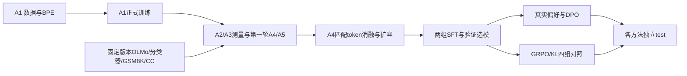

# 从零复现、显存约束与断点恢复

[← 结果首页](../README.md) · [五章教程](../README.md#学习与实现导航) · [课程笔记](https://github.com/lvsir18/CS336Spring-2026-Learning-Notes)

## 1. 环境与目录

所有命令在Linux项目根目录执行。实测为单卡RTX PRO 6000 Blackwell Server Edition，96GB标称显存，`nvidia-smi`报告97,887MiB；共享GPU，只允许本实验使用约40–50GB预算。训练进程设置42GiB的PyTorch allocator上限，队列空闲≥49GiB再启动，包装器启动前再检查≥48GiB。allocated、reserved与NVML显存口径不同，这些阈值不是整卡隔离或显存预留。

```bash
git clone https://github.com/lvsir18/CS336Spring-2026-Learning-Assignments.git
cd CS336Spring-2026-Learning-Assignments
bash scripts/setup_linux.sh
source .venv/bin/activate
python scripts/fetch_runtime_assets.py
```

安装脚本使用Python3.12、torch2.11.0/cu130并安装alignment/data/plots依赖。需要兼容Blackwell和CUDA13的驱动。完整实测依赖快照见[environment-lock](../provenance/environment-lock.txt)；它是历史参考，不假定所有机器可直接照搬其全部CUDA包。当前只发布关键实现，不携带测试依赖和测试文件。

| 目录 | 内容 | 是否进入Git |
|---|---|---|
| `src/`、`scripts/`、`configs/` | 实现、执行入口、版本化计划 | 是 |
| `results/`、`provenance/` | 数值证据、环境、数据摘要 | 是 |
| `data/`、`models/`、`runs/` | 语料、模型、训练状态 | 否 |
| `assets/`、`src/cs336_alignment/prompts/` | 按SHA256下载的运行资产 | 否 |

资产获取不下载上游测试。A5 prompts不打进仓库；安装后仍从项目源码目录运行脚本，不把不含prompts的wheel当作独立分发包使用。大数据和模型应放有足够空间的服务器目录；本次原服务器文件持续保留，发布过程没有改动其训练状态。

## 2. 完整依赖顺序



这是实测队列的执行依赖，不表示A5沿用A4的权重。A1、A4、A5使用不同模型/词表。

**第一阶段：A1**。从完整TinyStories来源文件准备tokenizer和token流，5000步训练：

```bash
mkdir -p runs/formal/a1-controller
nohup python -u scripts/run_formal_a1.py --endpoint https://huggingface.co \
  > runs/formal/a1-controller/controller.log 2>&1 < /dev/null &
```

等 `runs/formal/a1-controller/state.json` 显示complete。控制器包含数据准备、哈希验证和GPU训练，不需同时再启动单独的数据准备脚本。

**第二阶段：首轮A2–A5**。先获取固定版本公开资产，避免离线训练队列缺依赖：

```bash
python scripts/fetch_formal_assets.py --endpoint https://huggingface.co
mkdir -p runs/formal/remaining
nohup python -u scripts/run_remaining.py \
  > runs/formal/remaining/controller.log 2>&1 < /dev/null &
```

`plan_remaining.py`生成21项A2、9项A3、首轮A4/A5及拟合等任务。CPU helper准备GSM8K和网页语料，GPU任务串行运行。第一轮DPO使用构造负例，第一轮RL没有KL；它们是保留的历史基线，**最终推荐学习最新A5流程**。该队列的部分独立任务失败时仍可能继续，结束状态必须是complete且failures为空，不能只看最后一个GPU进程消失。

**第三阶段：A4/A5优化**。首轮完成后：

```bash
mkdir -p runs/optimization-v1
nohup python -u scripts/run_optimization.py \
  > runs/optimization-v1/controller.log 2>&1 < /dev/null &
```

这个31项队列依次进行恢复探针、A4六组对照/扩容、两组SFT、真实偏好、两组DPO、四组GRPO、验证选择与最终测试。恢复/KL探针是实际模型短训练，用于确认运行链路，不作为能力结果。优化队列任一阶段失败会停止，避免下游使用缺失依赖。它含一个引用首轮SFT的KL探针，因此不能跳过首轮直接从空目录启动。只复现部分作业可使用各章分解命令；不要同时启动完整队列和同目录手动任务。

队列生成的配置在`runs/.../configs/`，本次真实resolved configs另保存于[结果目录](../results)。发布版只调整运行资产路径和固定下载revision，核心训练数学没有变更。生成新实验时配置可随数据hash/目录不同，不能要求JSON字节摘要与旧配置完全相同。

## 3. 查看进度与结束条件

```bash
cat runs/optimization-v1/state.json
tail -n 20 runs/optimization-v1/controller.log
tail -n 2 runs/optimization-v1/rl-p4g8-kl01/metrics.jsonl
cat runs/optimization-v1/rl-p4g8-kl01/complete.json
nvidia-smi
```

`waiting_for_vram`是在等待共享显存，CPU下载/过滤/BPE阶段GPU利用率可以为0。单个任务的complete只表示该任务完成，整队列还需state为complete、全部预定job退出码0。A1检查step5000；A3各自达到预算步数；A4/SFT/DPO/RL分别检查配置step、best和exported_step；最终test检查examples=1319。

图表可完全由仓库中的数值结果重建：

```bash
python scripts/plot_results.py
```

此命令仅分析和绘图，不训练或下载模型。

## 4. 检查点保存什么

| 状态 | 作用 |
|---|---|
| model / optimizer / step | 恢复参数、Adam一二阶矩、步数与学习率位置 |
| Python / NumPy / Torch / CUDA RNG | 恢复数据抽样与生成随机序列 |
| config / 数据身份摘要 | 拒绝用不同架构、数据、batch或LR悄悄续训 |
| sampler seed / size / seen | SFT/DPO无放回epoch顺序与消费位置 |
| best selection | 恢复截至checkpoint时已经观察到的最佳验证权重 |

临时文件写入、flush/fsync、同目录原子替换；保留`checkpoint.pt`和`checkpoint.previous.pt`。`--resume auto`遇到最新文件不可读时尝试前一份。恢复时备份并截断超过checkpoint的未提交日志，后续step重新计算。只恢复seed或只保存权重都不能等价恢复Adam训练。

SFT/DPO的最后一个不满累积批次按实际样本数归一化。最佳权重以不可变`best-step-N.pt`保存；最终HF `model/`是最佳验证点，最新完整checkpoint是恢复点，二者可能不同。恢复到旧checkpoint时不能引用后来才选出的best。

偏好生成按题原子写入输出与RNG，恢复从连续已提交题目开始。扩容数据下载可复用缓存，重新组装不会重复接入已提交文档。机器/驱动变化仍可能造成浮点和采样差异；不保证所有GPU环境逐位一致。

## 5. 正常停止与恢复

先用`ps -fp <PID>`核对当前控制器身份，再向自己的控制器发TERM。例如：

```bash
ps -fp "$(cat runs/optimization-v1/controller.pid)"
kill -TERM "$(cat runs/optimization-v1/controller.pid)"
```

控制器转发信号；训练在完整optimizer更新边界保存。确认子任务和控制器退出后恢复：

```bash
nohup python -u scripts/run_optimization.py --resume \
  >> runs/optimization-v1/controller.log 2>&1 < /dev/null &
# 首轮：scripts/run_remaining.py --resume
# A1：scripts/run_formal_a1.py --resume
```

单个训练器可用 `scripts/train_lm.py --config <原配置> --resume auto` 或 `scripts/train_alignment_formal.py --config <原配置> --resume auto`，并同样包在gpu_budget中。文件锁防止同目录并发写入，不能靠删除锁文件绕过。正常停止不用SIGKILL；断电只能回到最近完整checkpoint。机器重启后需要重新启动队列，没有安装自动拉起服务。

## 6. 完成范围与证据

本次服务器状态重新核验为A1 complete、首轮complete且failures为空、优化轮complete/31项任务。原始训练源提交是`5b3e4054b7d233b7788b309d9cb533890863a9e7`，发布版仓库采用精简历史，二者commit不同。对应路径、原始hash与公开文件hash见[server-verification](../provenance/server-verification.json)。

结果JSON移除进程ID并规范化格式；逐题test只发布位置索引和评分，不附题目/答案/生成正文。图表和派生汇总不是新的训练结果。A2真实多GPU验证、A3大尺度外推、A4完整官方数据预算、A5多seed公平算法比较都仍未完成。
